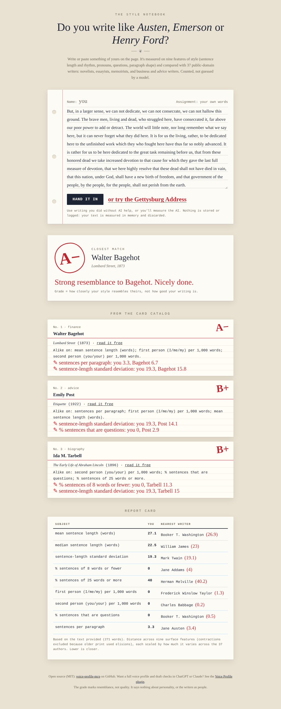

# voice-profile-mcp

**Do you write like Austen, Emerson or Henry Ford?** Paste your writing and find out, measured instead of guessed.

**[Try it in your browser →](https://voice-profile-mcp.vercel.app/)** No sign-up. Nothing is stored.

This server measures nine features of your style (sentence length and rhythm, pronouns, questions, paragraph shape) and compares them with 41 public-domain books by 40 writers: novelists, essayists, memoirists, and business, finance and advice writers, from Jane Austen to Benjamin Franklin to Ernest Hemingway. The numbers are counted in code, not estimated by a language model, so the same text always gets the same answer.

It's also the measurement engine behind the **[Voice Profile plugin](https://github.com/genideva/voice-profile)**, which builds a profile of how you write and checks AI drafts against it so they sound like you.

## Example

The Gettysburg Address, run through `compare_to_authors`:

| | Author | Work | Distance |
|---|---|---|---|
| 1 | Walter Bagehot | *Lombard Street* (1873) | 0.65 |
| 2 | Ida M. Tarbell | *The Early Life of Abraham Lincoln* (1896) | 0.69 |
| 3 | Emily Post | *Etiquette* (1922) | 0.70 |

Lincoln's second-closest match is a biography of Lincoln. And Hemingway's two novels in the library pick each other as closest match (0.39), without being told they share an author. Feature by feature, his 40% share of 25+ word sentences matches Melville almost exactly (40.2%), and his sentence-length variation matches Mark Twain (19.3 vs 19.1). Lower distance is closer.



## How it reads

Next to the author match, the page scores how the writing comes across, the way psychologists score personality in text: by counting word categories.

- **Five traits** (the Big Five, as expressed in text): Reserved–Outgoing, Cool–Warm, Loose–Organized, Concrete–Curious, Calm–Tense.
- **Four tone markers:** Argument (because, therefore, however), Hedging (perhaps, might), Certainty (clearly, always), Emphasis (very, really).

Each is placed on a five-level scale against the library, with the counts that drove it and a tip for moving it. The Gettysburg Address reads very outgoing (70 uses of *we/us/our* per 1,000 words; the library's typical is 10), very warm and very calm.

This describes the **writing, never the writer**. Word-category links to personality are real but modest, so it's a writing aid: change the words and the reading changes. The word lists live in [`api/_core/tone.py`](api/_core/tone.py), written for this project after the approach in Pennebaker & King (1999), Yarkoni (2010) and Schwartz et al. (2013). It is kept separate from the plugin's measuring code.

## Try it

- **In a browser:** [voice-profile-mcp.vercel.app](https://voice-profile-mcp.vercel.app/)
- **In ChatGPT:** install the [Voice Profile plugin](https://github.com/genideva/voice-profile). The server comes bundled, so there's nothing to connect by hand.
- **In Claude Code or Codex:** the same plugin runs these measurements on your own machine and never calls this server. To use the server's author comparison there too, add it as an MCP server (below).
- **From any MCP client:** the endpoint is `https://voice-profile-mcp.vercel.app/mcp` (streamable HTTP, no authentication).

```bash
npx @modelcontextprotocol/inspector --cli https://voice-profile-mcp.vercel.app/mcp --transport http \
  --method tools/call --tool-name compare_to_authors \
  --tool-arg 'text=Paste at least five sentences of your own writing here. ...'
```

**It stores nothing.** Every request is measured in memory and the result is returned. No database, no files, no request logging.

If this is useful, a ⭐ helps other people find it.

## Tools

| Tool | What it does |
|---|---|
| `analyze_writing` | Measures ten surface features of each writing sample (sentence length and variation, short and long sentence shares, contractions, first and second person, questions, paragraph length). With 8+ unlabeled samples it also suggests whether the writer has two distinct modes. |
| `build_voice_profile` | Turns labeled samples into a profile: a working range per feature, per writing mode, plus a cross-check of how distinct the modes are. Returns the profile for the user to save. |
| `check_draft` | Scores a draft against one mode of a saved profile. Pass or fail per feature, which way to move, and any banned words. |
| `compare_to_authors` | Compares a sample, or a profile, with 41 public-domain books, fiction and non-fiction, on measured style, and returns the closest authors and the closest author per feature. |

All four tools are read-only (`readOnlyHint: true`, `destructiveHint: false`, `openWorldHint: false`).

**Rules the server enforces:**
- A sample is measured only if `ai_touched` is `"no"`. AI-assisted text measures the assistant's version of the writer.
- Written prose only. Call transcripts stay with the client-side plugin, which removes other speakers before anything is measured.
- Limits: 60 samples and 120,000 words per request, 15,000 words per draft, a 1.5 MB body, and 60 requests per minute per client.

## The author library

`api/_core/authors.json` holds measured numbers, and no text, for 41 public-domain works from Project Gutenberg.

- **Fiction:** Austen, Dickens, Wilde, Melville, Shelley, Conan Doyle, Poe and Swift.
- **1920s novels:** Fitzgerald (*The Great Gatsby*), Woolf (*Mrs. Dalloway*) and Hemingway (*The Sun Also Rises*, *A Farewell to Arms*).
- **Essays and lectures:** Emerson, Wollstonecraft, Paine, Chesterton, Du Bois and William James.
- **Memoir:** Twain, Thoreau, Douglass, Franklin, Booker T. Washington, Helen Keller and Jane Addams.
- **Advice and business:** Arnold Bennett, Samuel Smiles, Emily Post, Frederick Winslow Taylor, Henry Ford and Andrew Carnegie.
- **Technology:** Charles Babbage, and Dyer and Martin's biography of Edison.
- **Finance:** Edwin Lefevre, Walter Bagehot and Charles Mackay.
- **Medical:** Florence Nightingale and Oliver Wendell Holmes Sr.
- **Biography:** Lytton Strachey, James Boswell and Ida M. Tarbell.

Every group after the novels is non-fiction, so a blog post, memo or advice piece has prose in its own register to sit near, not just novels. Each book is cut into chunks of about 1,500 words and measured with the same code as everything else.

Rebuild it with `python3 tools/build_authors.py <cache-dir>`.

The comparison leaves out contractions, because older printing used elisions ("receiv'd", "'tis") that distort the count. It compares style only. It makes no claims about personality, quality, or the authors as people.

## Same numbers as the plugin

`api/_core/textstats.py`, `build_profile.py` and `verify.py` are byte-for-byte copies of the plugin's scripts. `tests/test_server.py` checks that the copies are identical, and that a profile built through the server matches one built with the plugin's command-line tools. When the plugin's scripts change, copy them over and run the tests.

## Run it

```bash
python3 server.py            # http://localhost:8787/mcp
python3 -m unittest discover tests
```

There are no dependencies: standard-library Python only. Open http://localhost:8787/ in a browser for the try-it page (`api/_core/demo.html`).

**Deploying (Vercel):** `api/mcp.py` is the function and `vercel.json` routes `/mcp` and `/.well-known/openai-apps-challenge` to it. To pass OpenAI's domain verification, set the environment variable `OPENAI_APPS_CHALLENGE` to the token from the plugin dashboard.

## Privacy and terms

See [PRIVACY.md](PRIVACY.md) and the plugin's [TERMS.md](https://github.com/genideva/voice-profile/blob/main/TERMS.md).

## License

MIT
